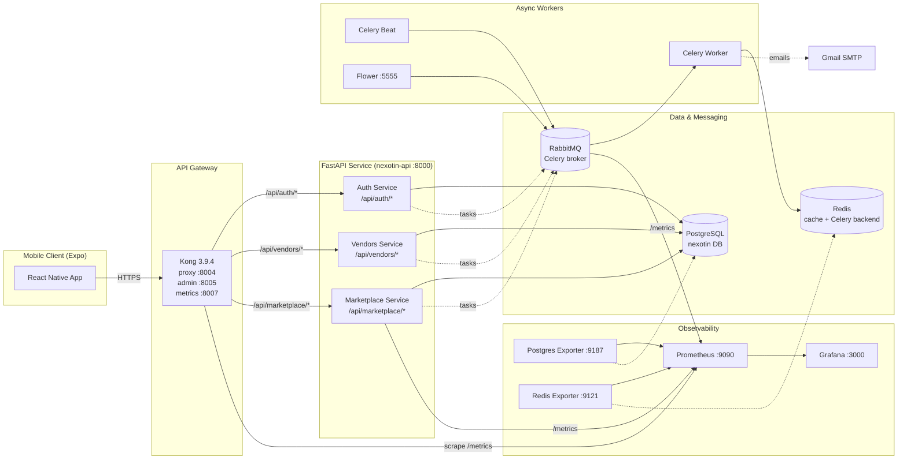

# Nexotin Architecture



## Components

| Layer | Technology | Port |
|---|---|---|
| API Gateway | Kong 3.9.4 (community) | 8004 (proxy), 8005 (admin), 8007 (metrics) |
| Backend | FastAPI (Python 3.12) | 8000 |
| Database | PostgreSQL 17 | 5432 |
| Cache | Redis 7 | 6379 |
| Message Broker | RabbitMQ 4 | 5672 (AMQP), 15672 (mgmt) |
| Task Worker | Celery | — |
| Task Monitor | Flower | 5555 |
| DB Admin | Adminer | 8081 |
| Redis Admin | RedisInsight | 5540 |
| Metrics | Prometheus | 9090 |
| Dashboards | Grafana | 3000 |
| PG Exporter | postgres-exporter | 9187 |
| Redis Exporter | redis-exporter | 9121 |

## Microservices (FastAPI routers)

- **Auth** (`/api/auth/*`): vendor/buyer register & login, JWT tokens
- **Vendors** (`/api/vendors/*`): products CRUD, vendor info, packages, verification, counts
- **Marketplace** (`/api/marketplace/*`): orders, catalog, search, reviews, subscriptions, buyers, delivery pricing

## Kong Routes

| Route | Path | Upstream |
|---|---|---|
| auth-route | `/api/auth` | nexotin-api:8000 |
| vendors-route | `/api/vendors` | nexotin-api:8000 |
| marketplace-route | `/api/marketplace` | nexotin-api:8000 |

## Plugins (Kong)

- `prometheus` (global) — metrics: latency, status codes, bandwidth, upstream health
- `rate-limiting` (marketplace-route) — 10 req/min per IP (demo)
```
